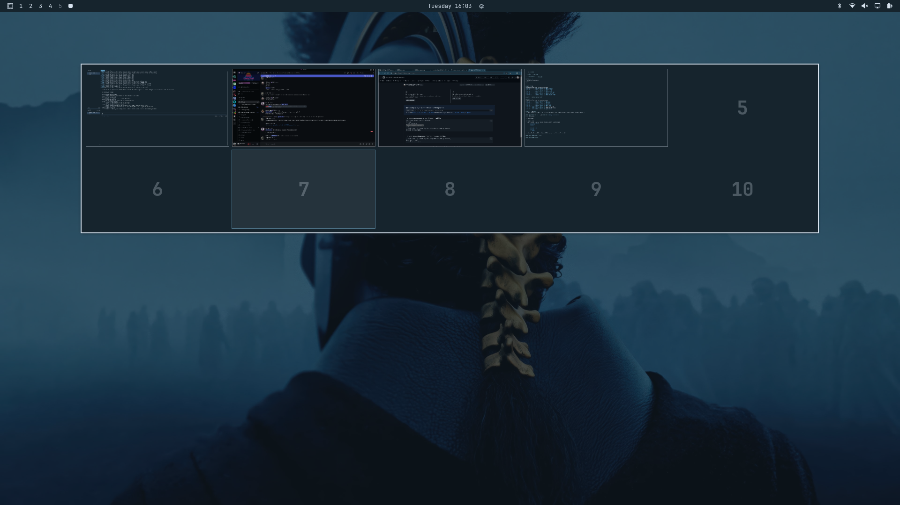

# Omarchy Overview Plugin

A Hyprland overview plugin: a mission-control window grid with a workspace strip and type-to-search, plus the classic workspace grid, with live window previews, theme integration, and app icon resolution for [Omarchy Shell](https://github.com/AyushKr2003/omarchy-dotfiles).



> 💡 **Credits & Attribution**: This plugin is adapted from and made compatible with Omarchy based on [Shanu-Kumawat/quickshell-overview](https://github.com/Shanu-Kumawat/quickshell-overview.git). The mission-control layout follows [dragosol/hyprdrive-omarchy](https://github.com/dragosol/hyprdrive-omarchy).

---

## Installation

### Via `omarchy plugin` (Recommended)

Install directly from GitHub using the Omarchy plugin CLI:

```bash
omarchy plugin add https://github.com/AyushKr2003/omarchy-overview.git
```

---

### Manual Installation

Clone or copy this folder directly into your Omarchy plugins directory:

```bash
mkdir -p ~/.config/omarchy/plugins/omarchy-overview
cp -r . ~/.config/omarchy/plugins/omarchy-overview/
```

Then rescan and enable the plugin:

```bash
omarchy plugin rescan
omarchy plugin enable omarchy-overview
```

---

## Uninstallation

### Via `omarchy plugin` (Recommended)

Remove the plugin using the Omarchy CLI:

```bash
omarchy plugin remove omarchy-overview
```

---

### Manual Uninstallation

```bash
omarchy plugin disable omarchy-overview
rm -rf ~/.config/omarchy/plugins/omarchy-overview
omarchy plugin rescan
```

---

## Keybinding & Usage

### Toggle via Shell IPC

```bash
omarchy-shell shell toggle omarchy-overview
```

### Hyprland Keybinding (`bindings.lua`)

Add the following binding to your `~/.config/hypr/bindings.lua`:

```lua
hl.unbind("SUPER + TAB")
o.bind("SUPER + TAB", "Overview", "omarchy-shell shell toggle omarchy-overview")
```

### Tap Super (optional)

To toggle the overview by tapping Super on its own, add a release bind.
Hyprland skips a release bind once another key is pressed during the hold,
so `SUPER + T`, `SUPER + SPACE` and the rest keep working:

```lua
o.bind("SUPER + SUPER_L", "Overview", "omarchy-shell shell toggle omarchy-overview", { release = true })
```

### Other IPC calls

```bash
qs ipc -p "$OMARCHY_PATH/shell" call overview search "firefox"   # open with a query
qs ipc -p "$OMARCHY_PATH/shell" call overview state              # open | closed
qs ipc -p "$OMARCHY_PATH/shell" call overview info               # JSON: query, results, tile geometry
```

---

## Mission control

The default layout (`"layout": "missionControl"`), modelled on
[Hyprdrive](https://github.com/dragosol/hyprdrive-omarchy)'s overview:

- **Window grid**: the focused desktop's windows as a grid of live previews
  that keep their relative sizes. Opening zooms every window out of its real
  place, and closing zooms it back. The grid reflows when a window opens or
  closes.
- **Wallpaper backdrop**: the overview sits on your wallpaper, blurred and
  dimmed, and follows theme changes. Each window carries its app icon on
  its bottom edge.
- **Workspace strip** across the top: a live thumbnail per desktop on this
  monitor, a `+` cell for a new desktop, and special workspaces (the
  scratchpad) detached on the right. Click a cell to switch desktops without
  leaving the overview, or double-click to switch and close.
- **Drag and drop**: drag a window onto a strip cell to move it there, onto `+`
  to give it a desktop of its own, or onto a special workspace. Hold a dragged
  window over another window for 1.5 s and let go to swap them. Hold it at
  the left or right screen edge to carry it to the previous or next desktop.
- **Type to search**: just start typing. Results cover open windows, apps,
  a calculator (`12*(3+4)`; Enter copies the answer), and Omarchy menu
  actions. Files (`fd`) and GNOME search providers (Nautilus and others) are
  opt-in.
- **Keyboard**: arrows move the selection between windows and up into the
  strip, Enter opens it, Tab walks strip → grid → next monitor.
- **Mouse**: click a window to focus it (the pointer moves into it),
  middle-click it (or select it and press Delete) to close it, scroll to step through desktops, and
  click empty space to close.
- **Several monitors**: every monitor shows its own desktop. The arrows and
  Tab cross between monitors, and search results show on the monitor the
  overview was opened from.
- **Hot corner** (off by default): resting the pointer in a screen corner
  opens the overview, and resting there again closes it.

The classic workspace grid is still available with `"layout": "grid"`.

---

## Configuration

Settings are read inline from `~/.config/omarchy/shell.json`, inside the
`plugins` array entry. Edits are picked up live:

```json
{
  "id": "omarchy-overview",
  "layout": "missionControl",
  "hotCorner": "top-right",
  "searchFiles": true
}
```

### Mission control settings

| Setting | Type | Default | Description |
| :--- | :--- | :--- | :--- |
| `layout` | `string` | `"missionControl"` | `"missionControl"` or `"grid"`. |
| `showStrip` | `boolean` | `true` | Workspace strip across the top. |
| `stripHeightPct` | `integer` | `17` | Strip height as a percent of the screen (max 30). |
| `missionControlGap` | `integer` | `32` | Gap between window tiles. |
| `reflowMs` | `integer` | `300` | How long a tile takes to glide to a new slot. |
| `openAnimation` | `boolean` | `true` | Zoom windows out on open and back on close. |
| `openAnimationMs` | `integer` | `280` | Open duration; close is 80% of it. Off when Hyprland animations are off. |
| `wallpaperBackdrop` | `boolean` | `true` | Show the current wallpaper behind the overview and in the strip. |
| `wallpaperBlur` | `boolean` | `true` | Blur that wallpaper. |
| `wallpaperDim` | `number` | `0.45` | How much the wallpaper is darkened. |
| `backdropOpacity` | `number` | `0.9` | Backdrop opacity when there is no wallpaper (or it is off). |
| `searchEnabled` | `boolean` | `true` | Type to search. |
| `searchMenu` | `boolean` | `true` | Include Omarchy menu actions. |
| `searchFiles` | `boolean` | `false` | Include files under `~` (needs `fd`). |
| `searchProviders` | `boolean` | `false` | Include GNOME search providers (D-Bus via `busctl`). |
| `holdToSwap` | `boolean` | `true` | Hold a dragged window over another to swap them. |
| `holdToSwapMs` | `integer` | `1500` | How long to hold before a swap. |
| `springEdges` | `boolean` | `true` | Hold a dragged window at a screen edge to change desktop. |
| `springDelayMs` | `integer` | `1500` | How long to hold at the edge. |
| `hotCorner` | `string` | `"off"` | `off`, `top-left`, `top-right`, `bottom-left` or `bottom-right`. |
| `hotCornerDelayMs` | `integer` | `150` | How long the pointer rests in the corner. |

### Workspace grid settings

| Setting | Type | Default | Description |
| :--- | :--- | :--- | :--- |
| `rows` | `integer` | `2` | Number of workspace grid rows. |
| `columns` | `integer` | `5` | Number of workspace grid columns. |
| `hideEmptyRows` | `boolean` | `true` | Hides empty rows automatically. |
| `showSpecialWorkspaces` | `boolean` | `false` | Includes special scratchpad workspaces. |
| `specialWorkspaceColumns` | `integer` | `5` | Columns count for special workspaces. |
| `showIcons` | `boolean` | `false` | Display resolution-matched app icons on window delegates. |

### Advanced settings (nested keys)

These go in the same entry as nested objects, e.g.
`{"id": "omarchy-overview", "overview": {"closeOnFocusLoss": false}, "missionControl": {"maxScale": 0.7}}`.

| Setting | Type | Default | Layout | Description |
| :--- | :--- | :--- | :--- | :--- |
| `missionControl.maxScale` | `number` | `0.85` | mission control | Largest size a window is drawn at in the grid, as a fraction of its real size. |
| `missionControl.dragMiniScale` | `number` | `0.45` | mission control | Size a dragged window shrinks to over a strip cell. |
| `overview.enable` | `boolean` | `true` | both | Turn the overview content off entirely. |
| `overview.closeOnFocusLoss` | `boolean` | `true` | both | Close when focus moves elsewhere (and, in the grid layout, on a click outside the panel). |
| `overview.previewsEnabled` | `boolean` | `true` | both | Live window previews; off draws empty frames. |
| `overview.specialWorkspaces` | `array` | `[]` | both | Special workspace names to always list, even when empty. |
| `overview.effects.enableBlur` | `boolean` | `false` | both | Use the `quickshell:overview-blur` layer namespace, for a Hyprland layer rule that blurs it. |
| `overview.scale` | `number` | `0.16` | grid | Workspace thumbnail scale. |
| `overview.useWorkspaceMap` | `boolean` | `false` | grid | Offset each monitor's workspace numbers by `overview.workspaceMap`. |
| `overview.workspaceMap` | `array` | `[]` | grid | Per-monitor workspace offset, indexed by monitor id. |
| `overview.orderRightLeft` | `boolean` | `false` | grid | Number workspaces right to left. |
| `overview.orderBottomUp` | `boolean` | `false` | grid | Number workspaces bottom to top. |
| `overview.includeInactiveMonitorPreviews` | `boolean` | `true` | grid | Capture previews of windows on other monitors. |
| `overview.workspaceSpacing` | `number` | `5` | grid | Gap between workspace thumbnails. |
| `overview.backgroundPadding` | `number` | `10` | grid | Padding inside the panel. |
| `overview.workspaceNumberBaseSize` | `number` | `250` | grid | Size of the workspace numbers. |
| `overview.effects.windowOverlayOpacity` | `number` | `0.22` | grid | Tint over each window preview. |
| `position.topMargin` | `integer` | `100` | grid | Distance of the panel from the top of the screen. |
| `windowPreview.iconToWindowRatio` | `number` | `0.25` | grid | App icon size relative to the window. |
| `windowPreview.iconToWindowRatioCompact` | `number` | `0.45` | grid | The same for small windows. |
| `windowPreview.inactiveMonitorOpacity` | `number` | `0.4` | grid | Opacity of windows from other monitors. |
| `windowPreview.cropToFill` | `boolean` | `false` | grid | Crop previews to fill their frame instead of fitting. |
| `appearance.animation.duration.elementMoveEnter` | `integer` | `400` | grid | Window preview motion. |
| `appearance.animation.duration.elementMoveFast` | `integer` | `200` | grid | Workspace indicator and tooltip transitions. |
| `appearance.sizes.elevationMargin` | `number` | `10` | grid | Room left around the panel for its shadow. |
| `hacks.hyprlandEventDebounceMs` | `integer` | `40` | both | Debounce for Hyprland event refreshes. |
| `hacks.arbitraryRaceConditionDelay` | `integer` | `150` | both | Delay before the focus grab is taken after opening. |

---

## Features & Omarchy Integration

- **Live Window Previews**: Renders real-time Hyprland window thumbnails across workspaces.
- **Dynamic App Icon Resolution**: Resolves standard GUI apps, webapps/PWAs (Chrome/Brave/Edge), and terminal TUI apps (Yazi, Neovim, btop, ranger) matching `omarchy.menu`.
- **Theme Integration**: Follows active Omarchy shell theme tokens (`qs.Commons.Color` & `qs.Commons.Style`).
- **HiDPI Scaling**: Automatically scales icon rendering by `Screen.devicePixelRatio` for sharp rendering.
- **App search and launching** go through the shell's own app library (the
  manifest declares the `menu` kind to receive it), so hidden entries and
  launch feedback match the Omarchy menu.

### Network use

None. File search runs `fd` locally, and the search providers are local
D-Bus services.

---

## Credits

- Original Quickshell Overview by [Shanu-Kumawat/quickshell-overview](https://github.com/Shanu-Kumawat/quickshell-overview.git).
- Adapted for Omarchy shell plugin architecture, IPC, and icon library integration by [AyushKr2003](https://github.com/AyushKr2003).
- Mission-control behaviour (grid, strip, search, hold-to-swap, hot corner) after [dragosol/hyprdrive-omarchy](https://github.com/dragosol/hyprdrive-omarchy).

---

## License

This project is licensed under the [MIT License](LICENSE).
